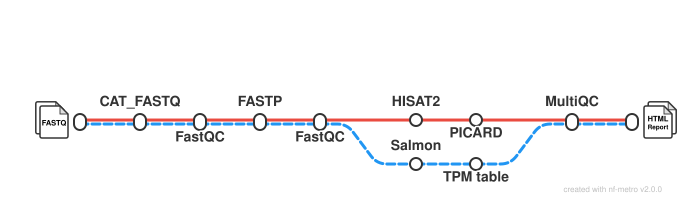

# NinaBee13/Computational_Workflows_project_RoehreSchuele

## Introduction

**NinaBee13/Computational_Workflows_project_RoehreSchuele** is a bioinformatics pipeline that ingests RNA sequencing data, and provides the user with a comprehensive summary of the processing steps within the pipeline. The input should have the form of a samplesheet, with FASTQ files, strandedness, and sample ids. This input is than processed by a series of RNA-sep processing steps, such as Quality Control (FASTQC), trimming and quality filtering(FASTP), pseudo-/alignment  and quantification (HISAT2, Salmon), marking of duplicate reads (PICARD).
The pipeline accepts single-end or paired-end FASTQ files, including multiple
sequencing runs per biological sample. Reads may be merged per sample, quality
controlled and trimmed before being processed in two parallel analysis branches.
HISAT2 is used for genome alignment and Salmon for transcript/gene abundance
estimation. Alignment and quality-control statistics are summarized with MultiQC.


<!-- TODO nf-core: Include a figure that guides the user through the major workflow steps. Many nf-core
     workflows use the "tube map" design for that. See https://nf-co.re/docs/community/brand/workflow-schematics#examples for examples.   -->

<!-- TODO nf-core: Fill in short bullet-pointed list of the default steps in the pipeline -->
1. Optional: merge duplicate FastQ files ([`cat`](https://www.linfo.org/cat.html))
2. Read QC of raw reads ([`FastQC`](https://www.bioinformatics.babraham.ac.uk/projects/fastqc/))
3. Adapter and quality trimming ([`FastP`](https://github.com/opengene/fastp))
4. Read QC of trimmed reads ([`FastQC`](https://www.bioinformatics.babraham.ac.uk/projects/fastqc/))
5. Alignment with HISAT2 ([`HISAT2`](https://daehwankimlab.github.io/hisat2/)) [Alignment Branch]
6. Duplicate read marking ([`Picard`](https://broadinstitute.github.io/picard/)) [Alignment Branch]
7. Pseudoalignment and quantification ([`Salmon`](https://combine-lab.github.io/salmon/)) [Quantification Branch]
8. Sort and index alignments ([`SAMtools`](https://sourceforge.net/projects/samtools/files/samtools/)) [Quantification Branch]
9. Import quantification results and generate the TPM table([`tximeta`](https://bioconductor.org/packages/release/bioc/html/tximeta.html)) [Quantification Branch]
10. Present QC for raw reads, trimmed reads, alignment, and TPM table ([`MultiQC`](http://multiqc.info/))

## Usage

> [!NOTE]
> If you are new to Nextflow and nf-core, please refer to [this page](https://nf-co.re/docs/get_started/environment_setup/overview) on how to set-up Nextflow. Make sure to [test your setup](https://nf-co.re/docs/get_started/run-your-first-pipeline) with `-profile test` or `-profile test_without_duplicates` before running the workflow on actual data.

<!-- TODO nf-core: Describe the minimum required steps to execute the pipeline, e.g. how to prepare samplesheets.
     Explain what rows and columns represent. For instance (please edit as appropriate):

First, prepare a samplesheet with your input data that looks as follows:

`samplesheet.csv`:

```csv
sample,fastq_1,fastq_2, strandedness
CONTROL_REP1,AEG588A1_S1_L002_R1_001.fastq.gz,AEG588A1_S1_L002_R2_001.fastq.gz, reverse
```

Each row represents a fastq file (single-end) or a pair of fastq files (paired end).

-->
### Samplesheet

The input samplesheet must contain the following columns: sample, fastq_1, fastq_2, strandedness.  The sample column presents the sample ID. Repeat the same ID on several rows if a sample was sequenced in multiple runs, and set the -concat_duplicate_samples flag to true.   Fastq_1 and Fastq_2 require a path to the fastq files. Leave Fastq_2 empty for single-end sequencing data. The strandedness column represent the library strandedness: 'forward', 'reverse', 'unstranded', or 'auto'. If strandedness is set to 'auto', the strandedness is inferred by Salmon ('--libType A'). 
This is an example how a samplesheet should look:

```csv
sample,fastq_1,fastq_2,strandedness
WT_REP1,/path/run1_R1.fastq.gz,/path/run1_R2.fastq.gz,reverse
WT_REP1,/path/run2_R1.fastq.gz,/path/run2_R2.fastq.gz,reverse
WT_REP2,/path/WT_REP2_R1.fastq.gz,/path/WT_REP2_R2.fastq.gz,reverse
```
Now, you can run the pipeline using:

```bash
nextflow run Computational_Workflows_project_RoehreSchuele \
    -profile docker \
    --input samplesheet.csv \
    --fasta reference.fa \
    --gtf annotation.gtf \
    --outdir results \
    --concat_duplicate_samples false
```
The flags --fasta, --gtf, --input, --profile and --outdir are required parameters. The pipeline builts HISAT2 and Salmon indices from files provided under the --fasta/--gtf flags.
<!-- TODO nf-core: update the following command to include all required parameters for a minimal example -->

For a minimal example run:

```bash
nextflow run Computational_Workflows_project_RoehreSchuele \
    -profile test_without_duplicates,docker \
    --outdir test_results
```
This test set uses an modified samplesheet, without duplicate sample id's. Please note that if there are duplicate sample id's in the samplesheet, the pipeline will throw an error. If the intention is to merge these runs, this can be done using the flag --concat_duplicate_samples true. If this flag is set to anything but false, the pipeline will automatically merge the samples. The default setting for the flag is false. 

See the minimal example run "test,docker" for merging samples with the same ID:
```bash
nextflow run Computational_Workflows_project_RoehreSchuele \
    -profile test,docker \
    --outdir test_results \
    --concat_duplicate_samples true
    
```
> [!WARNING]
> Please provide pipeline parameters via the CLI or Nextflow `-params-file` option. Custom config files including those provided by the `-c` Nextflow option can be used to provide any configuration _**except for parameters**_; see [docs](https://nf-co.re/docs/running/run-pipelines#using-parameter-files).

## Credits

Computational_Workflows_project_RoehreSchuele was originally written by Nina Röhre, Laura Schüle for the course Computational Workflows at the University of Tuebingen. 

## Contributions and Support

If you would like to contribute to this pipeline, please see the [contributing guidelines](docs/CONTRIBUTING.md).

## Citations

<!-- TODO nf-core: Add citation for pipeline after first release. Uncomment lines below and update Zenodo doi and badge at the top of this file. -->
<!-- If you use NinaBee13/cw-rnaseq-roehre-schuele for your analysis, please cite it using the following doi: [10.5281/zenodo.XXXXXX](https://doi.org/10.5281/zenodo.XXXXXX) -->

An extensive list of references for the tools used by the pipeline can be found in the [`CITATIONS.md`](CITATIONS.md) file.

This pipeline uses code and infrastructure developed and maintained by the [nf-core](https://nf-co.re) community, reused here under the [MIT license](https://github.com/nf-core/tools/blob/main/LICENSE).

> **The nf-core framework for community-curated bioinformatics pipelines.**
>
> Philip Ewels, Alexander Peltzer, Sven Fillinger, Harshil Patel, Johannes Alneberg, Andreas Wilm, Maxime Ulysse Garcia, Paolo Di Tommaso & Sven Nahnsen.
>
> _Nat Biotechnol._ 2020 Feb 13. doi: [10.1038/s41587-020-0439-x](https://dx.doi.org/10.1038/s41587-020-0439-x).
